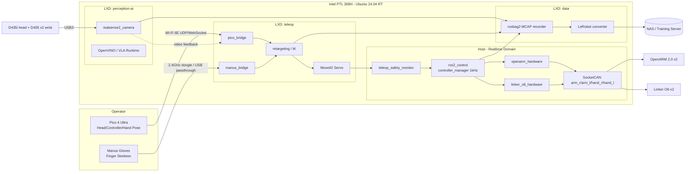
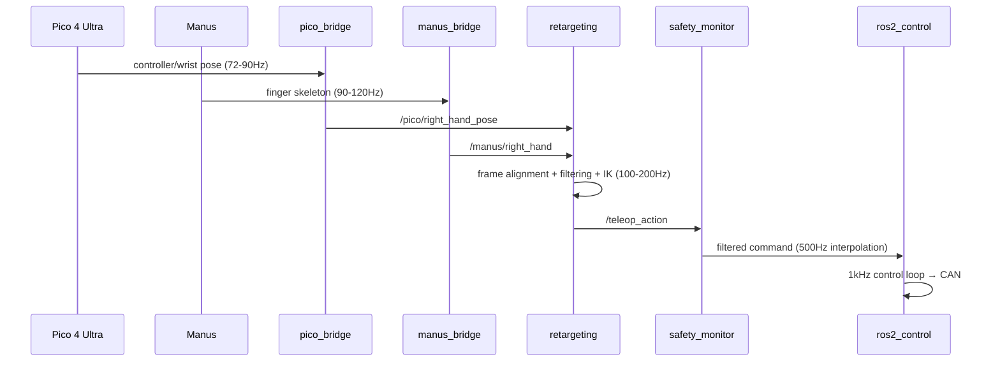
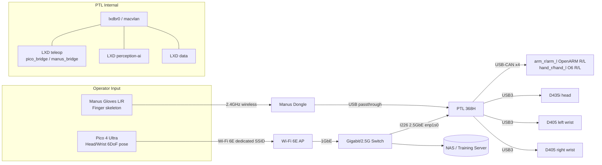

# Implementation Plan: Intel Robotics AI Suite Teleoperation & Data Collection Platform

> Based on [architecture_request.md](architecture_request.md)
> Goal: Pico 4 Ultra + Manus Gloves → teleoperate OpenARM 2.0 + Linker Bot O6 → multi-modal data collection → demonstration dataset (Imitation Learning / VLA)

---

## 0. Scope and Assumptions

| Item | Description |
|---|---|
| Compute | Intel PTL 368H, Ubuntu 24.04 LTS, PREEMPT_RT, iGPU/NPU, NVMe, I226 |
| Software | ROS2 Jazzy, ros2_control, MoveIt2, OpenVINO, Intel Robotics AI Suite |
| Arms | OpenARM 2.0, Anvil Robotics edition ([anvil-robotics/openarm](https://github.com/anvil-robotics/openarm); Damiao motors, candleLight USB-CAN, classic CAN 1 Mbps, one CAN bus per arm) |
| Dexterous hands | Linker Bot O6 (USB-CAN or vendor interface, left and right) |
| XR | Pico 4 Ultra (Wi-Fi 6/6E streaming of head / controller / hand tracking) |
| Hand mocap | Manus Gloves (Manus Linux SDK, dongle connected directly to PTL via USB) |
| Cameras | Head: RealSense D435i x1; Wrists: RealSense D405 x2 (one per hand) |
| Container solution | **Confirmed: LXD Hybrid (Host + LXD)** |

Assumptions and decisions:
- A single PTL 368H handles real-time control, perception, and recording; model training runs on an offline GPU server.
- Manus uses **Option A**: the dongle is USB-passed-through to the LXD `teleop` container and `manus_bridge` reads it directly via the Manus Linux SDK. No extra Windows PC.

---

## 1. System Architecture

### 1.1 Overall Architecture



### 1.2 Layered Architecture

| Layer | Content |
|---|---|
| L6 Application | Teleop UI, episode management, dataset conversion, VLA inference |
| L5 AI / Perception | OpenVINO, VLA runtime, RealSense processing |
| L4 Motion | Retargeting, IK, MoveIt2 Servo, safety filter |
| L3 Control | ros2_control, controller_manager, JTC / forward controllers |
| L2 Hardware Abstraction | openarm_hardware, linker_o6_hardware (SystemInterface) |
| L1 Driver / Bus | SocketCAN (gs_usb/candleLight, classic CAN 1 Mbps, udev names by serial), librealsense, Manus SDK |
| L0 OS / Platform | Ubuntu 24.04 + PREEMPT_RT, CPU isolation, LXD, Intel GPU/NPU drivers |

### 1.3 Runtime / Control / Data Flow
- **Control flow**: Pico/Manus → bridge → retarget → safety → controller → hardware → CAN. Unidirectional and interruptible by `safety_monitor` (deadman / timeout / velocity limits).
- **Data flow**: All sensors and commands are published as ROS2 topics → raw recording with `rosbag2 (MCAP)` → offline conversion to LeRobot dataset.
- **Time sync**: `use_sim_time=false` system-wide, chrony; Pico timestamps are re-stamped on receipt in the bridge while keeping the original timestamp.

---

## 2. Container Strategy Analysis

| Criterion | Docker | LXD | Hybrid (Host + LXD) |
|---|---|---|---|
| Realtime | Requires `--privileged`, `--cap-add SYS_NICE`, `--ulimit rtprio`; workable but tedious | System container, rtprio configurable, cgroup tuning more complex | **RT loop runs directly on host; best** |
| CAN access | Needs `--network host`; SocketCAN is a netdev, hard to isolate | `nic` passthrough of CAN interfaces | **Native on host, no extra abstraction** |
| USB access | `--device` not hot-plug friendly | `usb` device + udev rules, hot-plug supported | LXD USB passthrough (cameras / Manus) |
| GPU/NPU access | `--device /dev/dri /dev/accel`, mature | `gpu` device works | LXD gpu device; nested Docker inside LXD possible |
| DDS discovery | Host network simplest; bridge network multicast limited | Multicast works on bridge network | Multicast works on lxdbr0 / macvlan; unified Domain ID |
| Security | Weak by default (almost none when privileged) | Unprivileged containers, AppArmor | RT part on host (strictly managed), the rest isolated |
| Isolation | Process level | Full OS level | Per functional domain |
| Maintenance | Good image versioning, CI friendly | Good snapshots / profiles | Moderate |
| Intel Robotics AI Suite compatibility | Official Docker images / Debian packages | Debian packages | **Debian packages or nested Docker inside LXD** |

**Single recommendation (confirmed): LXD Hybrid (Host + LXD)**
- Host: PREEMPT_RT, SocketCAN, ros2_control, hardware interfaces, safety monitor (hard real-time, low latency, minimal failure surface).
- LXD: three system containers - teleop, perception-ai, data - with profiles for USB/GPU/network and snapshots for versioning.
- Dockerized Intel Robotics AI Suite components can run as nested Docker inside the `perception-ai` LXD (`security.nesting=true`).

---

## 3. Component Deployment Matrix

| Component | Host | LXD | Docker | Reason |
|---|:-:|:-:|:-:|---|
| OpenARM SDK (openarm_can) | ✅ | | | Same process as hardware interface; needs RT and direct CAN access |
| SocketCAN | ✅ | | | Kernel netdev; host manages bitrate (systemd-networkd) and udev naming |
| OpenARM Driver (openarm_hardware) | ✅ | | | ros2_control plugin, 1 kHz RT loop |
| Linker Driver (linker_o6_hardware) | ✅ | | | Same as above; shares controller_manager |
| ros2_control | ✅ | | | RT threads, CPU isolation |
| MoveIt2 (Servo / Planning) | | ✅ teleop | | Not hard real-time; same domain as retargeting |
| RealSense (D435i x1 + D405 x2) | | ✅ perception-ai | | USB3 passthrough by serial number; same domain as image processing |
| Manus SDK / manus_bridge | | ✅ teleop | | Dongle USB passthrough; same domain as retargeting |
| OpenVINO | | ✅ perception-ai | (opt) | Uses iGPU/NPU; official images can run nested |
| VLA Runtime | | ✅ perception-ai | (opt) | Frequent model changes; needs isolation |
| rosbag2 | | ✅ data | | Dedicated NVMe mount to avoid I/O interference with RT |

---

## 4. ROS2 Package Design

| Package | Node | Interface | Message Type | Rate | Responsibility |
|---|---|---|---|---|---|
| `openarm_description` | - | URDF/xacro | - | - | Dual arm + O6 hand model, TF, camera extrinsics |
| `openarm_hardware` | (plugin) | SystemInterface | - | 1 kHz | OpenARM CAN I/O, position/velocity/torque interfaces |
| `linker_o6_hardware` | (plugin) | SystemInterface | - | 100-200 Hz | O6 hand 6-DoF control and state |
| `openarm_bringup` | `controller_manager`, `robot_state_publisher` | launch / yaml | - | 1 kHz | Controller configuration and startup |
| `pico_bridge` | `pico_bridge_node` | UDP/WebSocket → ROS | `geometry_msgs/PoseStamped`, `sensor_msgs/Joy` | 72-90 Hz | Receive Pico head/controller/hand pose, frame conversion |
| `manus_bridge` | `manus_bridge_node` | Manus SDK → ROS | `teleop_msgs/HandSkeleton` | 90-120 Hz | Finger skeleton and joint angles |
| `teleop_retargeting` | `arm_retarget_node`, `hand_retarget_node` | sub pose / skeleton, pub cmd | `teleop_msgs/TeleopAction`, `trajectory_msgs/JointTrajectory` | 100-200 Hz | Wrist pose → arm IK; fingers → O6 joint mapping |
| `teleop_safety` | `safety_monitor_node` | sub cmd, pub filtered cmd | `std_msgs/Float64MultiArray`, `teleop_msgs/SafetyState` | 500 Hz | Deadman, timeout stop, joint/velocity/workspace limits |
| `teleop_msgs` | - | msg/srv | custom | - | HandSkeleton, TeleopAction, Episode, SafetyState |
| `openarm_moveit_config` | `servo_node` | MoveIt Servo | `geometry_msgs/TwistStamped` | 100-200 Hz | Cartesian servo with singularity/collision avoidance (optional path) |
| `camera_bringup` | `head_camera` (D435i), `left_wrist_camera` / `right_wrist_camera` (D405) | sensor | `sensor_msgs/Image`, `CameraInfo`, `Imu` | 30 Hz (IMU 200 Hz) | Launch by serial number, RGB/Depth/IMU, timestamp alignment |
| `episode_manager` | `episode_manager_node` | srv / action | `teleop_msgs/srv/Episode` | event | Start/stop/label/discard episodes, control recorder |
| `data_recorder` | `recorder_node` | rosbag2 API | - | - | MCAP recording, metadata, disk monitoring |
| `dataset_tools` | CLI | offline | - | - | MCAP → LeRobot / HDF5 / RLDS conversion, quality checks |
| `vla_runtime` | `vla_policy_node` | sub obs, pub action | `teleop_msgs/TeleopAction` | 10-30 Hz | OpenVINO inference, replay validation |

---

## 5. Teleoperation Pipeline



### 5.1 Pico4 Tracking
- A Pico OpenXR app (custom Unity/OpenXR app or an XRoboToolkit-like solution) captures head / controller / hand pose.
- Transport: dedicated Wi-Fi 6E AP, UDP (low latency) with sequence numbers and timestamps; video feedback via WebRTC/H.264.
- Frame conversion: XR world frame → operator calibration frame (button-triggered calibration) → robot base frame, with scaling factor.
- Clutch: follow only while the trigger is held; freeze on release (prevents drift).

### 5.2 Manus Tracking
- Manus SDK provides a 25-point hand skeleton and finger joint angles.
- Wrist pose comes from Pico (Manus has no absolute positioning); Manus provides fingers only.

### 5.3 Robot Command Generation
- **Arm**: wrist pose → low-pass / One-Euro filter → numerical IK (TRAC-IK / KDL / Pinocchio) → joint targets → `forward_position_controller` or JTC.
- **Hand**: Manus joint angles → linear / optimization-based retargeting (dex-retargeting) → O6 6-DoF.
- **Safety**: joint limits, velocity/acceleration limits, workspace box, 100 ms communication timeout stop, physical E-stop.

### 5.4 Frequency Configuration

| Module | Rate | Notes |
|---|---|---|
| ros2_control (OpenARM) | 1 kHz | RT thread, isolcpus |
| Safety monitor / interpolation | 500 Hz | Fills gaps from lower-rate upstream commands |
| Linker O6 control | 100-200 Hz | Depends on O6 communication capability |
| Retargeting / IK | 100-200 Hz | Upsampled to controller |
| MoveIt Servo | 100-200 Hz | Optional |
| Manus | 90-120 Hz | SDK output rate |
| Pico pose | 72-90 Hz | Display refresh rate |
| /joint_states | 100-500 Hz | Downsampled to 100 Hz for recording |
| RealSense RGB/Depth | 30 Hz | D435i head + D405 wrist x2 |
| D435i IMU | 200 Hz | Unified accel/gyro output |
| Dataset alignment | 30 Hz | Image stream as master clock |
| VLA inference | 10-30 Hz | Action chunking |

---

## 6. Data Collection Architecture

### 6.1 Camera Configuration

| Position | Model | Namespace | RGB | Depth | Other | Mounting / TF |
|---|---|---|---|---|---|---|
| Head | RealSense D435i | `/camera/head` | 640x480 @30 Hz | 640x480 @30 Hz (aligned to color) | IMU 200 Hz | Fixed to head link, `/tf_static` |
| Left wrist | RealSense D405 | `/camera/left_wrist` | 640x480 @30 Hz | 640x480 @30 Hz (short range 7-50 cm) | No IMU | Mounted on left wrist link, moves with arm TF |
| Right wrist | RealSense D405 | `/camera/right_wrist` | 640x480 @30 Hz | 640x480 @30 Hz (short range 7-50 cm) | No IMU | Mounted on right wrist link, moves with arm TF |

Key settings:
- Identify each camera by `serial_no`, fix devices with udev rules, and pass through to `perception-ai` via LXD `usb` devices (vendorid/productid + serial).
- Connect the three cameras to different USB3 controllers / root hubs to avoid bandwidth contention; enable `align_depth` and `global_time_enabled`.
- D405 has no external sync connector; all three cameras are aligned by software timestamps (head camera is master clock during dataset conversion, tolerance ±16 ms).
- Extrinsics: head camera calibrated head→base with a calibration board; wrist cameras via hand-eye calibration (`easy_handeye2`) wrist→camera; results written into URDF.
- Video to Pico: head D435i RGB by default, switchable to wrist views for fine manipulation.

### 6.2 Collected Data

| Modality | Source Topic | Recording Rate |
|---|---|---|
| RGB | `/camera/{head,left_wrist,right_wrist}/color/image_raw` | 30 Hz |
| Depth | `/camera/*/aligned_depth_to_color/image_raw` | 30 Hz |
| Head IMU | `/camera/head/imu` | 200 Hz |
| Joint States | `/joint_states` | 100 Hz |
| Base States | `/odom`, `/base/state` (if a mobile base exists) | 50 Hz |
| End Effector Pose | `/left_ee_pose`, `/right_ee_pose` | 100 Hz |
| TF Tree | `/tf`, `/tf_static` | raw |
| Operator Actions | `/teleop_action` | 100 Hz |
| Hand Skeleton | `/manus/{left,right}_hand` | 90 Hz |
| XR Pose | `/pico/*_pose` | 72-90 Hz |
| Metadata | `/episode/status` | event |

### 6.3 Format Comparison

| Format | Pros | Cons | Use |
|---|---|---|---|
| rosbag2 (MCAP) | Native, zero conversion, full TF/timestamps, Foxglove visualization | Not directly trainable | **Raw recording** |
| LeRobot Dataset | Parquet + MP4, HF Hub ecosystem, works directly with ACT/Diffusion/π0 | Requires conversion and alignment | **Official training format** |
| OpenX (RLDS/TFDS) | Cross-robot large-scale dataset standard | Heavy TF dependency, complex tooling | External publication |
| HDF5 | Simple, native to ACT/ALOHA | Large uncompressed images, no standard schema | Legacy compatibility |

**Recommendation**:
- **Raw layer**: rosbag2 MCAP (zstd compression, images via compressed / ffmpeg_image_transport).
- **Official dataset**: **LeRobot Dataset** (30 Hz aligned, observation.images.* / observation.state / action).
- **Export**: convert from LeRobot to RLDS (OpenX) or HDF5 when needed.

### 6.4 Episode Flow
1. Operator presses a Pico button → `episode_manager` starts recording (task prompt, operator id).
2. Task completed → label success/fail → stop recording.
3. Background `dataset_tools` validation (frame drops, time offsets, joint jumps) → convert to LeRobot → upload to NAS.

---

## 7. ROS2 Topic / Interface Matrix

| Topic | Msg Type | Publisher | Subscriber | Rate | QoS |
|---|---|---|---|---|---|
| `/joint_states` | `sensor_msgs/JointState` | joint_state_broadcaster | robot_state_publisher, retarget, recorder | 100-500 Hz | Reliable, Volatile, KeepLast 10 |
| `/tf` | `tf2_msgs/TFMessage` | robot_state_publisher, pico_bridge | all | 100 Hz | Reliable, Volatile, KeepLast 100 |
| `/tf_static` | `tf2_msgs/TFMessage` | robot_state_publisher, camera | all | latched | Reliable, TransientLocal, KeepLast 1 |
| `/cmd_vel` | `geometry_msgs/TwistStamped` | teleop (base) | base_controller | 50 Hz | Reliable, Volatile, KeepLast 1 |
| `/left_arm_controller/commands` | `std_msgs/Float64MultiArray` | safety_monitor | forward_position_controller | 500 Hz | Reliable, KeepLast 1 (controller subscription is Reliable) |
| `/right_arm_controller/commands` | same | safety_monitor | forward_position_controller | 500 Hz | Reliable, KeepLast 1 |
| `/arm_controller/joint_trajectory` | `trajectory_msgs/JointTrajectory` | MoveIt / replay | JTC | event | Reliable, KeepLast 1 |
| `/left_gripper_controller/commands` | `std_msgs/Float64MultiArray` | safety_monitor | O6 forward controller | 500 Hz | Reliable, KeepLast 1 |
| `/right_gripper_controller/commands` | same | safety_monitor | O6 forward controller | 500 Hz | Reliable, KeepLast 1 |
| `/manus/left_hand` | `teleop_msgs/HandSkeleton` | manus_bridge | hand_retarget, recorder | 90-120 Hz | BestEffort, KeepLast 5 |
| `/manus/right_hand` | same | manus_bridge | hand_retarget, recorder | 90-120 Hz | BestEffort, KeepLast 5 |
| `/pico/head_pose` | `geometry_msgs/PoseStamped` | pico_bridge | retarget, recorder | 72-90 Hz | BestEffort, KeepLast 5 |
| `/pico/left_hand_pose` | `geometry_msgs/PoseStamped` | pico_bridge | arm_retarget, recorder | 72-90 Hz | BestEffort, KeepLast 5 |
| `/pico/right_hand_pose` | same | pico_bridge | arm_retarget, recorder | 72-90 Hz | BestEffort, KeepLast 5 |
| `/pico/buttons` | `sensor_msgs/Joy` | pico_bridge | safety, episode_manager | 72 Hz | Reliable, KeepLast 10 |
| `/teleop_action` | `teleop_msgs/TeleopAction` | retargeting / vla_policy | safety_monitor, recorder | 100 Hz | Reliable, KeepLast 1 |
| `/teleop/safety_state` | `teleop_msgs/SafetyState` | safety_monitor | UI, recorder | 50 Hz | Reliable, KeepLast 1 |
| `/left_ee_pose`, `/right_ee_pose` | `geometry_msgs/PoseStamped` | fk_publisher | recorder, VLA | 100 Hz | BestEffort, KeepLast 1 |
| `/camera/head/color/image_raw` | `sensor_msgs/Image` | realsense (D435i) | recorder, VLA, pico_bridge | 30 Hz | SensorData (BestEffort) |
| `/camera/head/aligned_depth_to_color/image_raw` | `sensor_msgs/Image` | realsense (D435i) | recorder, VLA | 30 Hz | SensorData |
| `/camera/{left,right}_wrist/color/image_raw` | `sensor_msgs/Image` | realsense (D405) | recorder, VLA, pico_bridge | 30 Hz | SensorData |
| `/camera/{left,right}_wrist/aligned_depth_to_color/image_raw` | `sensor_msgs/Image` | realsense (D405) | recorder, VLA | 30 Hz | SensorData |
| `/camera/head/imu` | `sensor_msgs/Imu` | realsense (D435i) | recorder | 200 Hz | SensorData |
| `/camera/*/camera_info` | `sensor_msgs/CameraInfo` | realsense | recorder | 30 Hz | SensorData |
| `/robot_state` | `teleop_msgs/RobotState` | state_aggregator | UI, recorder | 50 Hz | Reliable, KeepLast 1 |
| `/dynamic_joint_states` | `control_msgs/DynamicJointState` | joint_state_broadcaster | recorder (current/temperature) | 100 Hz | Reliable, KeepLast 10 |
| `/diagnostics` | `diagnostic_msgs/DiagnosticArray` | drivers | UI, recorder | 1 Hz | Reliable, KeepLast 10 |
| `/episode/status` | `teleop_msgs/EpisodeStatus` | episode_manager | recorder, UI | event | Reliable, TransientLocal, KeepLast 1 |
| `/emergency_stop` | `std_msgs/Bool` | UI / Pico / physical button | safety_monitor | event | Reliable, TransientLocal, KeepLast 1 |

> Note: `/arm_controller` and `/gripper_controller` in the original request are controller namespaces; the actual topics are expanded above by controller type.

---

## 8. Final Deliverables

### 8.1 Final Architecture Diagram
See §1.1 (Overall) and §5 (Teleop Sequence).

### 8.2 Final Deployment Table
See §3.

### 8.3 Final Network Topology



- Operator input: **Pico 4 Ultra** (wrist/head pose over Wi-Fi) and **Manus Gloves** (finger skeleton via Manus 2.4 GHz dongle).
- Manus (Option A): dongle USB-passed-through to LXD `teleop`; `manus_bridge` reads via Manus Linux SDK.
- Cameras: D435i and two D405 on separate USB3 controllers, passed through to LXD `perception-ai`.
- Fixed ROS_DOMAIN_ID (e.g. 42), RMW `rmw_cyclonedds_cpp`, Cyclone restricted to `lxdbr0` + `enp1s0`.
- Pico on the same subnet as the robot with a dedicated SSID; power saving disabled.

### 8.4 Final Container Solution (Confirmed: LXD Hybrid)
- **Host**: `openarm_bringup` (ros2_control + hardware + safety) as a systemd service, `SCHED_FIFO` priority 80, pinned to isolated P-cores.
- **LXD `teleop`**: pico_bridge, manus_bridge, retargeting, MoveIt2; USB passthrough of Manus dongle.
- **LXD `perception-ai`**: realsense (D435i + D405 x2, USB passthrough by serial), OpenVINO, VLA runtime; gpu + `/dev/accel` (NPU) passthrough; `security.nesting=true`.
- **LXD `data`**: recorder, episode_manager, dataset_tools; dedicated NVMe partition mounted at `/data`.
- Each LXD is versioned via profiles with regular snapshots.

### 8.5 Final ROS2 Package Tree

```
ros2_ws/src/
├── description/
│   ├── openarm_description/
│   └── openarm_moveit_config/
├── hardware/
│   ├── openarm_hardware/          # Host
│   ├── linker_o6_hardware/        # Host
│   └── openarm_bringup/           # Host
├── teleop/
│   ├── teleop_msgs/
│   ├── pico_bridge/               # LXD teleop
│   ├── manus_bridge/              # LXD teleop
│   ├── teleop_retargeting/        # LXD teleop
│   └── teleop_safety/             # Host
├── perception/
│   ├── camera_bringup/            # LXD perception-ai
│   └── vla_runtime/               # LXD perception-ai
├── data/
│   ├── episode_manager/           # LXD data
│   ├── data_recorder/             # LXD data
│   └── dataset_tools/             # LXD data (Python CLI)
└── system/
    ├── system_bringup/            # full-system launch
    └── system_config/             # DDS/QoS/LXD profile/udev
```

### 8.6 Implementation Steps

| Phase | Work | Deliverables | Acceptance Criteria |
|---|---|---|---|
| **P0 Platform setup** | Install per Intel Robotics AI Suite [Getting Started](https://developer.robotics.intel.com/2026.3/development-stack/platform_foundation/getting_started/) (Ubuntu 24.04, RT kernel, GPU/NPU drivers, ROS2 Jazzy, OpenVINO are validated by Intel; no separate validation) | Installation log | Installed per official documentation |
| **P1 Containers & network** | LXD profiles (teleop / perception-ai / data), lxdbr0, Cyclone DDS config, udev rules; verify Manus dongle and RealSense passthrough | LXD profile yaml, DDS xml | Host ↔ LXD `ros2 topic` visible both ways; Manus/RealSense/GPU/NPU passthrough working |
| **P2 Hardware drivers** | SocketCAN setup, `openarm_hardware`, `linker_o6_hardware`, URDF, ros2_control config | Hardware packages, bringup launch | Dual arm stable at 1 kHz, O6 open/close, correct RViz display; manual joint-space control via rqt / keyboard (not Pico/Manus teleop) |
| **P3 Safety layer** | `teleop_safety`, E-stop, soft limits, timeout stop | Safety package, test report | Stop within 100 ms of disconnect; E-stop 100% effective |
| **P4 Teleoperation** | Pico app + `pico_bridge`, `manus_bridge`, retargeting/IK, calibration flow | Teleop packages, operator manual | End-to-end latency < 100 ms; pick-and-place achievable |
| **P5 Perception & recording** | D435i (head) + D405 x2 (wrist) bringup and calibration (head extrinsics, wrist hand-eye), `episode_manager`, `data_recorder`, MCAP recording | Recording system, calibration results | All three cameras 30 Hz with < 1% frame drop; no control loop overrun during recording |
| **P6 Dataset** | `dataset_tools`: MCAP → LeRobot, quality checks, upload to NAS | Conversion tools, dataset spec | LeRobot loads dataset and trains ACT baseline |
| **P7 AI closed loop (optional)** | Reference Intel Robotics AI Suite OpenVINO-optimized ACT / Diffusion Policy / Pi0.5 / RDT pipelines, deploy to `vla_runtime` | Inference node | Model inference ≥ 10 Hz on iGPU/NPU; demo task succeeds |
| **P8 Documentation & delivery** | ADD, SDS, Deployment Guide, operating SOP | Documents | A new engineer can deploy following the documents |

### 8.7 Rationale
1. **Real-time first**: control chain (ros2_control + CAN) stays on the host RT kernel, avoiding container jitter and device access issues.
2. **Isolation and maintainability**: teleop, AI, and data recording live in separate LXDs that can be upgraded, snapshotted, and rolled back independently; AI model updates do not affect control.
3. **Intel platform optimization**: OpenVINO runs perception and VLA on iGPU/NPU, keeping CPU P-cores for RT control.
4. **Data usability**: MCAP preserves full raw data; LeRobot is the official training format, compatible with mainstream IL/VLA models and exportable to OpenX.
5. **Safety**: dedicated safety layer + hardware E-stop + communication timeout for human-in-the-loop teleoperation.
6. **Extensibility**: unified `teleop_msgs/TeleopAction` interface allows seamless switching between human teleoperation and VLA policy on the same control chain.
